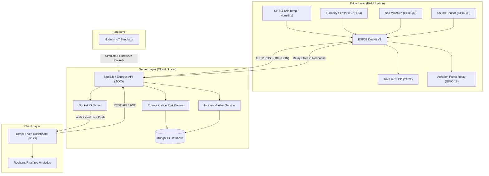

# 🌊 AquaSense — Smart Lake Health Monitoring & Eutrophication Management System

[](https://nodejs.org)
[](https://expressjs.com)
[](https://react.dev)
[](https://vitejs.dev)
[](https://mongodb.com)
[](https://espressif.com)
[](https://socket.io)

An autonomous IoT edge-to-cloud environmental monitoring platform designed to detect, track, and remediate **eutrophication cascades** in freshwater lakes, urban wetlands, and aquaculture water bodies.

---

## 🌟 Key Highlights

- **Edge Hardware Integration**: ESP32 microcontroller reading DHT11, Turbidity (NTU), Bioacoustic sound (dB-rel), Lake-bank Soil Moisture (%), driving an Aeration Pump Relay (GPIO 18) and a 16x2 I2C LCD.
- **Signal Processing**: 10-sample ADC averaging with an insertion-sort **median filter** on the ESP32 to eliminate electrical noise spikes.
- **Eutrophication Risk Engine**: Weighted heuristic calculating Eutrophication Risk Index (0–100), Oxygen Stress Index, and 5-stage ecological progression (Oligotrophic → Influx → Bloom → Decomposition → Hypoxia).
- **Automated Actuation**: Autonomous or manual aeration actuator trigger with anti-cycling cooldown timers to restore dissolved oxygen during anoxic events.
- **Glassmorphic React Dashboard**: High-fidelity dark/light UI with animated SVG gauges, Recharts multi-axis correlation graphs, live Socket.IO push, and CSV/PDF export.
- **Hardware Simulator**: Full Node.js IoT simulator to test normal, runoff, bloom, and cyclic scenarios without physical sensors.

---

## 🏗️ System Architecture



---

## 📋 Hardware Pin Connections

| Component | Sensor Pin | ESP32 Pin | Function |
|---|---|---|---|
| **DHT11** | DATA | **GPIO 13** | Air Temperature & Relative Humidity |
| **Turbidity Sensor** | Analog OUT | **GPIO 34** (ADC1) | Suspended particulates & algae (NTU) |
| **Sound Sensor** | Analog OUT | **GPIO 35** (ADC1) | Aquatic bioactivity & biological acoustic levels |
| **Soil Moisture** | Analog OUT | **GPIO 32** (ADC1) | Lake-bank agricultural runoff proxy |
| **Relay Module** | IN / Signal | **GPIO 18** | Aeration pump actuator (Dissolved O2 injection) |
| **16x2 LCD** | SDA / SCL | **GPIO 21 / 22** | On-site live telemetry & status readout |

*Detailed wiring schematics and calibration equations are located in [`docs/wiring.md`](file:///c:/Users/HP/Desktop/Smart%20water%20farm%20lake%20M%20S/docs/wiring.md).*

---

## 🚀 Quick Start Guide

### Prerequisites
- [Node.js](https://nodejs.org/) (v18 or higher)
- [MongoDB](https://www.mongodb.com/try/download/community) running locally on port 27017 (or MongoDB Atlas URI)
- Optional: Arduino IDE for flashing ESP32 firmware

---

### Step 1: Backend Setup
```bash
cd backend
npm install
node seed.js    # Populates initial thresholds, demo accounts, and 24h sample telemetry
npm run dev     # Starts Express & Socket.IO server on http://localhost:5000
```

> **Default Demo Credentials:**
> - **Administrator:** `admin@lakemonitor.com` / `admin123` (Full control)
> - **Viewer:** `viewer@lakemonitor.com` / `viewer123` (Read-only access)

---

### Step 2: Frontend Setup
```bash
cd frontend
npm install
npm run dev     # Starts Vite development server on http://localhost:5173
```
Open **`http://localhost:5173`** in your browser.

---

### Step 3: Run Hardware Simulator (No physical ESP32 required!)
To demonstrate the platform running live with simulated real-time data:
```bash
cd simulator
npm install
npm start       # Starts streaming simulated packets every 10 seconds
```

**Run predefined environmental incident scenarios:**
```bash
npm run bloom    # Simulates rapid algal bloom + hypoxia collapse (risk > 70, triggers pump)
npm run runoff   # Simulates agricultural rainstorm runoff surge (soil moisture > 85%)
npm run healthy  # Simulates healthy, clear oligotrophic lake (risk < 20)
```

---

### Step 4: ESP32 Hardware Firmware (If using physical hardware)
1. Open [`firmware/lake_monitor/lake_monitor.ino`](file:///c:/Users/HP/Desktop/Smart%20water%20farm%20lake%20M%20S/firmware/lake_monitor/lake_monitor.ino) in Arduino IDE.
2. Install required libraries: `DHT sensor library`, `LiquidCrystal_I2C`, `ArduinoJson`.
3. Configure your WiFi credentials and Server IP in the firmware:
   ```cpp
   const char* WIFI_SSID = "Your_WiFi_Name";
   const char* WIFI_PASS = "Your_WiFi_Password";
   const char* SERVER_URL = "http://192.168.1.100:5000/api/readings";
   ```
4. Connect ESP32 via micro-USB and click **Upload**.

---

## 🐳 Docker Deployment (One-Command Launch)

You can launch the entire stack (MongoDB, Backend, and Frontend) in Docker containers:
```bash
docker-compose up --build
```
- Frontend: `http://localhost:5173`
- Backend API: `http://localhost:5000`

---

## 🔬 Eutrophication Risk Formula

The Eutrophication Risk Index $R \in [0, 100]$ is computed by the backend risk engine using normalized sensor inputs:

$$R = w_t \cdot \hat{T}_{turb} + w_m \cdot \hat{M}_{soil} + w_{temp} \cdot \hat{T}_{temp} + w_s \cdot (1 - \hat{S}_{bio})$$

Where:
- $\hat{T}_{turb}$: Normalized Turbidity ($0–100\text{ NTU}$)
- $\hat{M}_{soil}$: Normalized Runoff Soil Moisture ($0–100\%$)
- $\hat{T}_{temp}$: Thermal acceleration index above $25^\circ\text{C}$
- $\hat{S}_{bio}$: Bioacoustic sound level (attenuation indicates anoxic silence)
- $w_t = 0.35, w_m = 0.25, w_{temp} = 0.25, w_s = 0.15$ (Configurable in Settings)

---

## 📁 Repository Directory Structure

```
Smart water farm lake M S/
├── backend/                  # Node.js + Express + Socket.IO + Mongoose
│   ├── models/               # Reading, Alert, Threshold, Device, User
│   ├── routes/               # REST API route handlers
│   ├── services/             # Risk engine & Alert notification service
│   ├── seed.js               # Database seeding script
│   └── server.js             # Application entry point
├── frontend/                 # React 18 + Vite + Tailwind CSS + Recharts
│   ├── src/
│   │   ├── components/       # RiskGauge, GaugeCard, CascadeIndicator, RelayControl, etc.
│   │   ├── pages/            # Overview, Analytics, Alerts, Settings, Reports, Login
│   │   ├── context/          # AuthContext, ThemeContext
│   │   └── hooks/            # useSocket.js
├── firmware/
│   └── lake_monitor/         # ESP32 Arduino C++ firmware (.ino)
├── simulator/                # Standalone Node.js hardware & scenario simulator
├── docs/                     # Schematics, presentation script, calibration guide
│   ├── wiring.md             # Hardware pinout and voltage guide
│   └── demo-script.md        # College presentation walkthrough script
└── docker-compose.yml        # Docker orchestrator
```

---

## 📜 License & College Project Notice
Developed for academic engineering demonstration. Open source under the MIT License.
